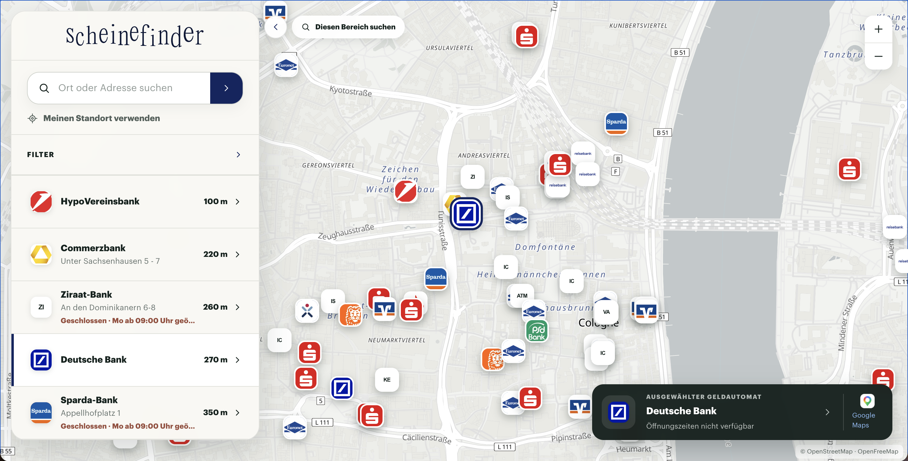
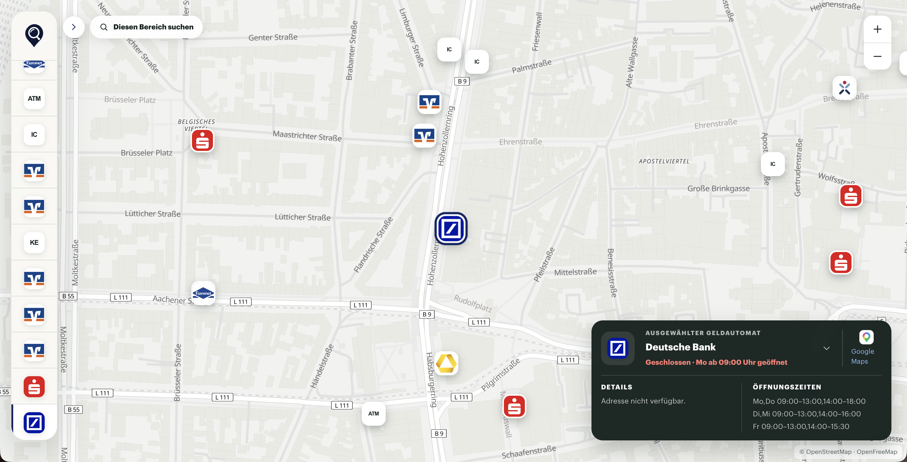
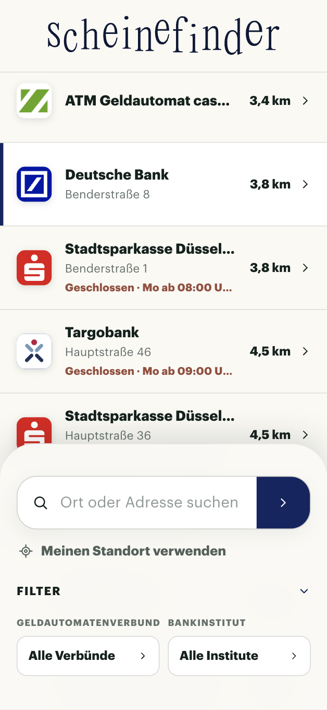
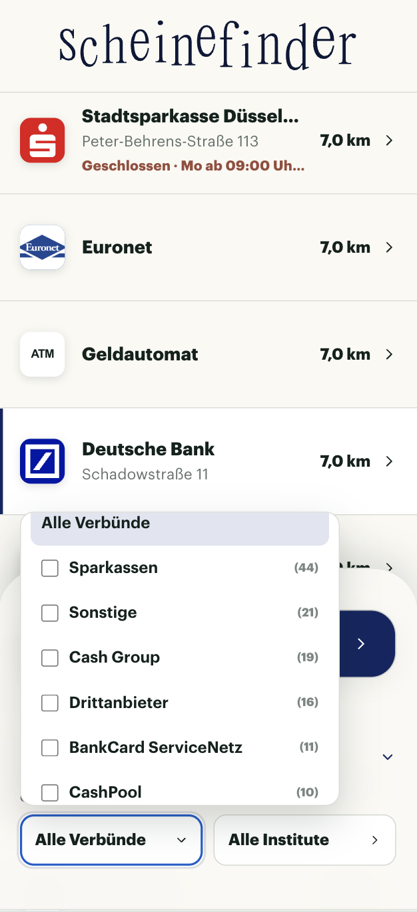
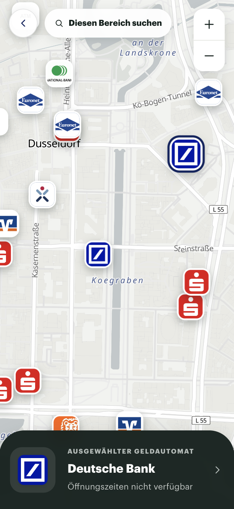
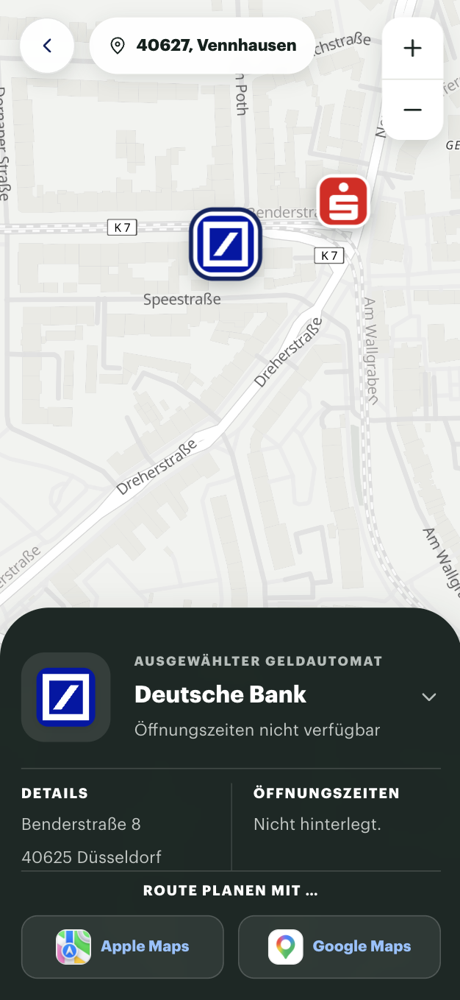

# Scheinefinder

Der Scheinefinder ist eine Next.js-Anwendung zum Finden und Filtern von Geldautomaten.
Die Karte basiert auf MapLibre/OpenFreeMap; Geldautomatendaten kommen aus OpenStreetMap
und werden ggf. mit den Einträgen aus `data/custom-atms.json` überschrieben.

## Preview

**[https://scheinefinder.vercel.app/](https://scheinefinder.vercel.app/)**

<p align="left">
  
  
</p>

<p align="left">
  
  
  
  
</p>

## Development

```bash
npm install
npm run dev
```

Qualitätsprüfungen laufen mit:

```bash
npm run check
```

Der Befehl führt Typecheck, ESLint und Unit-Tests aus. Ein Produktionsbuild kann
zusätzlich mit `npm run build` geprüft werden.

`app/page.tsx` setzt nur die ATM-Finder-Funktion zusammen. Der Hook
`useAtmFinder` koordiniert UI-Zustand und asynchrone Abläufe; er enthält keine
Formatierungs- oder Klassifikationsregeln. Komponenten rendern jeweils einen klar
abgegrenzten Teil der Oberfläche. Domänenregeln in `lib/atms` bleiben frei von React
und Next.js und sind dadurch direkt testbar.

Externe Geocoding- und Overpass-Aufrufe werden ausschließlich über Route Handler
ausgeführt. Diese validieren Eingaben, begrenzen Suchbereiche und geben nur die für
das Frontend benötigten Felder zurück.
